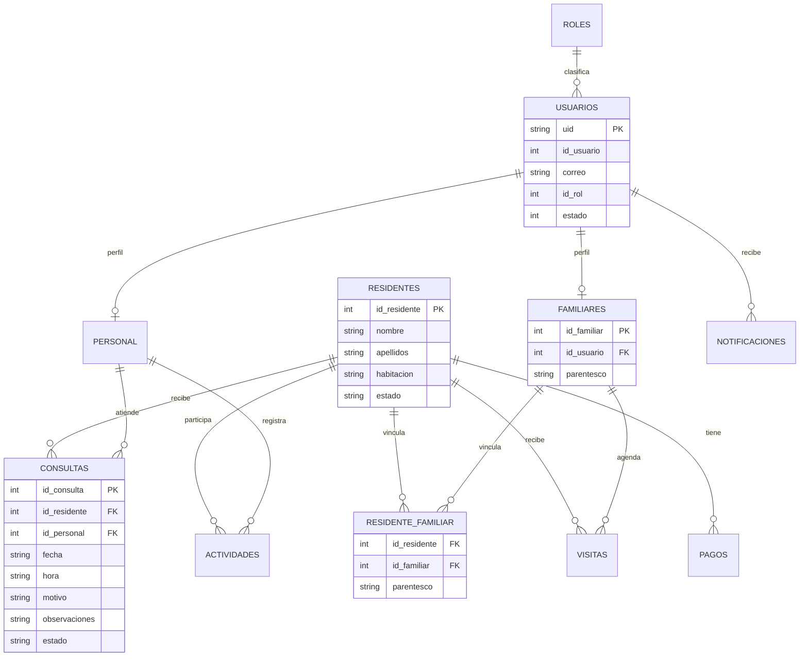
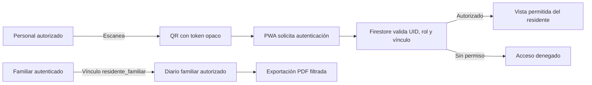

# Especificación y propuesta de PWA: Asilo 360

## Portada

| Dato | Información |
|---|---|
| Proyecto | Asilo 360 |
| Documento | Especificación inicial de la PWA |
| Integrantes | [Por completar] |
| Institución | [Por completar] |
| Materia | [Por completar] |
| Profesora | [Por completar] |
| Fecha de elaboración | 13 de octubre de 2026 |
| Fecha de entrega | [Por confirmar] |
| Versión | 1.0, propuesta para revisión |

> No se compartieron integrantes, institución, materia, profesora, fecha de entrega ni rúbrica. Esos campos quedan pendientes para no inventar información.

## 1. Propósito y alcance

Este documento especifica una **Progressive Web App (PWA) independiente de la aplicación Android actual**. La PWA tendría frontend, experiencia de usuario y despliegue web propios; podría conectarse al proyecto Firebase existente si se confirma que corresponde al entorno correcto y se configuran reglas adecuadas.

El repositorio revisado contiene hoy una aplicación Android nativa en Kotlin y Jetpack Compose, no una PWA. Sus modelos y código Firebase sirven como referencia del dominio y de las colecciones, pero no implican que el frontend web ya exista.

### Problema que atiende

Una residencia coordina residentes, cuidadores, familiares, consultas, actividades, visitas, pagos y avisos. Si la información está repartida entre conversaciones, documentos y sistemas separados, cuesta consultar el contexto de un residente, coordinar al equipo y mantener informada a su familia. La PWA propone una experiencia web común y adaptable para organizar esas tareas con permisos diferenciados.

### Visión

Facilitar una atención residencial coordinada y centrada en cada persona mediante una herramienta accesible desde teléfono, tableta o computadora, que ayude al equipo a registrar información útil y a los familiares autorizados a mantenerse informados.

### Objetivos

1. Implementar una PWA instalable y adaptable, independiente del cliente Android.
2. Diferenciar acceso y funciones para administración, personal y familiares.
3. Consultar los residentes y eventos relacionados con permisos explícitos.
4. Proponer como núcleo un QR protegido, un diario familiar y reportes PDF, sujeto a aprobación del alcance.
5. Diseñar reglas que protejan datos personales y de salud; no incluir contraseñas en Firestore.
6. Validar los flujos con usuarios antes de ampliar funciones como alertas y notificaciones push.

## 2. Estado actual verificado en el repositorio

| Tema | Estado encontrado |
|---|---|
| Cliente actual | Android nativo, Kotlin, Jetpack Compose. La PWA web aún no existe en el repositorio. |
| Firebase | El cliente Android usa Firebase Authentication y Cloud Firestore. |
| Colecciones observadas | `usuarios`, `roles`, `residentes`, `personal`, `familiares`, `residente_familiar`, `consultas`, `actividades`, `visitas`, `pagos` y `notificaciones`. |
| Rol del usuario | Campo `id_rol` numérico en el documento `usuarios`; el código mapea 1 administrador, 2 personal y 3 familiar. No encontré uso de custom claims en el cliente. |
| Vínculo familiar | `familiares.id_usuario` identifica el usuario familiar; `residente_familiar` conecta `id_familiar` con `id_residente` y puede guardar `parentesco`. |
| Reglas | No encontré un archivo `firestore.rules` en el repositorio. Las reglas activas solo se pueden confirmar en Firebase Console. |
| Consultas | El modelo actual incluye residente, personal, fecha, hora, motivo, observaciones y estado. No tiene campos explícitos de diagnóstico ni indicaciones. |
| Medicamentos | No encontré colección, modelo Kotlin ni horarios de medicamentos. Una alerta de dosis omitida requiere primero modelar y probar este proceso. |
| Plan Firebase | La captura compartida anteriormente mostraba Spark. Confirmar el plan actual en Firebase Console antes de depender de Functions u otros servicios con facturación. |

## 3. Modelo de datos actual

Los tipos siguientes reflejan las clases Kotlin y los mapas de escritura que se encontraron. Firestore es schemaless: puede haber documentos antiguos con campos o tipos distintos. Antes de desarrollar la PWA, conviene exportar o muestrear documentos de cada colección y normalizar los tipos.

| Colección | Campos principales observados | Observaciones |
|---|---|---|
| `usuarios` | `id_usuario: Int`, `nombre: String`, `apellido_paterno: String?`, `apellido_materno: String?`, `correo: String`, `telefono: String?`, `id_rol: Int`, `rol: String`, `estado: Int/Boolean/String` | Las capturas muestran IDs numéricos y `estado: 1`. El alta de personal crea documentos nuevos con ID de documento igual al UID de Auth; el login también busca por correo como compatibilidad. No guardar `password` aquí. |
| `roles` | `id_rol: Int`, `nombre: String` | La app también tiene los roles definidos en Kotlin. El código no depende de consultar esta colección para traducir el rol. |
| `residentes` | `id_residente: Int`, `nombre: String`, `apellido_paterno: String`, `apellido_materno: String?`, `fecha_nacimiento: String?`, `sexo: String?`, `habitacion: String?`, `fecha_ingreso: String?`, `estado: String?`, `observaciones: String?` | Se crean documentos con ID numérico secuencial y campos de identidad/estancia. |
| `personal` | `id_personal: Int`, `id_usuario: Int`, `puesto: String`, `fecha_ingreso: String?`, `estado: Int` | Nombre, apellidos, correo y teléfono se obtienen del documento relacionado en `usuarios`. La contraseña no forma parte del documento persistido. |
| `familiares` | `id_familiar: Int`, `id_usuario: Int`, `parentesco: String?`, `telefono: String?` | El cliente consulta estos campos para identificar familiares asociados a usuarios. |
| `residente_familiar` | `id_residente: Int`, `id_familiar: Int`, `parentesco: String?` | Tabla puente muchos-a-muchos. El código también contiene un fallback por `id_usuario`; verificar si ese campo realmente existe en los documentos antes de depender de él. |
| `consultas` | `id_consulta: Int`, `id_residente: Int`, `id_personal: Int`, `fecha: String`, `hora: String`, `motivo: String`, `observaciones: String?`, `estado: String` | `nombre_residente`, `nombre_personal` y `puesto_personal` se enriquecen al leer mediante relaciones. No son sustituto de IDs ni campos clínicos nuevos. |
| `actividades` | `id_actividad: Int`, `id_residente: Int`, `id_personal: Int`, `fecha: String`, `hora: String`, `tipo: String`, `descripcion: String` | Nombre del residente, habitación y nombre del personal se agregan al consultar. |
| `visitas` | `id_visita: Int`, `id_residente: Int`, `id_familiar: Int`, `fecha: String`, `hora: String`, `numero_visitantes: Int`, `estado: String` | Nombre/habitación del residente, nombre del familiar y parentesco se derivan de otras colecciones. |
| `pagos` | `id_pago: Int`, `id_residente: Int`, `monto: Double`, `fecha_pago: String`, `concepto: String`, `metodo_pago: String`, `estado: String` | El nombre del residente se resuelve al leer. Los registros pueden incluir información financiera; aplicar permisos estrictos. |
| `notificaciones` | `id_notificacion: Int`, `id_usuario: Int`, `titulo: String`, `mensaje: String`, `tipo: String`, `leida: Boolean`, `fecha: String` | El destinatario y rol se resuelven con el usuario. El modelo contempla además `id_referencia` y `tipo_referencia`, que deben validarse en los documentos. |

### Convención de IDs observada

Las operaciones de escritura usan documentos con ID numérico secuencial y un documento auxiliar `_counter` para varias colecciones. En `usuarios` coexisten documentos heredados con ID numérico y perfiles creados con UID de Firebase Auth. Para la PWA se recomienda acordar una migración hacia `usuarios/{uid}` y conservar `id_usuario` solo como identificador de negocio, sin crear perfiles duplicados.

### Esquema de relaciones actual



Las relaciones del diagrama son referencias por campos, no restricciones de llave foránea automáticas como en SQL. Las reglas de Firestore deben verificar los vínculos permitidos.

## 4. Roles, vínculos y permisos

### Cómo se asignan hoy

El cliente Android obtiene `id_rol` y `rol` desde `usuarios`. La enumeración del código es: `1 = Administrador`, `2 = Personal`, `3 = Familiar`. No encontré lectura de custom claims. En consecuencia, para la PWA los claims son una **mejora recomendada**, no una función actual.

### Vínculo entre familiar y residente

1. Buscar `familiares` por `id_usuario` del perfil autenticado.
2. Obtener el `id_familiar` correspondiente.
3. Buscar `residente_familiar` por `id_familiar`.
4. Leer solo los `residentes` con `id_residente` relacionado.

El acceso familiar no debe basarse solo en ocultar enlaces de la interfaz. Las reglas del servidor deben impedir que un familiar cambie el ID en una consulta y lea residentes ajenos.

### Controles requeridos antes del piloto

- Crear o localizar las reglas activas desde Firebase Console y guardarlas bajo control de versiones como `firestore.rules`.
- Denegar por defecto y abrir operaciones campo por campo o colección por colección.
- Proteger `id_rol`, `estado`, vínculos familiares y datos clínicos frente a escrituras del propio usuario.
- Preferir claims asignados por un entorno confiable o una Cloud Function para decisiones de autorización de alto impacto.
- Probar con cuentas separadas para administrador, personal y dos familiares con residentes distintos.
- No usar reglas de prueba abiertas ni confiar en el selector de rol del cliente.

## 5. Consultas médicas: brecha del modelo

El modelo actual permite guardar:

- `id_consulta`, `id_residente`, `id_personal`
- `fecha`, `hora`
- `motivo`, `observaciones`
- `estado`

No aparecen propiedades explícitas para `diagnostico`, `indicaciones`, `tratamiento`, `seguimiento` o `signos_vitales`. Aunque `observaciones` puede contener texto, no conviene usarlo como reemplazo ambiguo para esos datos.

**Decisión pendiente:** acordar con personal responsable qué información se registra, quién puede leerla, quién puede escribirla y cuánto tiempo se conserva. Si se aprueba ampliar el modelo, una propuesta inicial sería:

```text
consultas/{id_consulta}
  id_residente: number
  id_personal: number
  fecha: string (ISO 8601)
  hora: string (HH:mm)
  motivo: string
  diagnostico: string?       // solo si el proceso profesional lo requiere
  indicaciones: string?      // acceso limitado al personal autorizado
  observaciones: string?
  estado: string
  creado_por_uid: string
  creado_en: timestamp
  actualizado_en: timestamp
```

Este bloque es una propuesta de esquema, no una descripción de campos que ya existan.

## 6. Medicamentos y alerta de dosis omitida

No hay colección ni modelo de medicamentos, y no se encontraron horarios de administración. Por eso **la alerta “medicamento omitido” no es viable con los datos actuales**. Antes de prometer esa función hay que validar el proceso de prescripción, administración, registro de omisiones y escalamiento con responsables clínicos.

Modelo futuro sujeto a validación:

```text
medicamentos/{id_medicamento}
  id_residente: number
  nombre: string
  dosis: string
  via: string
  instrucciones: string
  horarios: array<timestamp o regla validada>
  fecha_inicio: timestamp
  fecha_fin: timestamp?
  activo: boolean
  prescrito_por_uid: string

administraciones_medicamento/{id_administracion}
  id_medicamento: string
  id_residente: number
  programada_para: timestamp
  administrada_en: timestamp?
  estado: "pendiente" | "administrada" | "omitida" | "cancelada"
  registrada_por_uid: string?
  motivo_omision: string?
```

La alerta necesitaría un mecanismo confiable del lado del servidor; una PWA cerrada no puede garantizar tareas programadas. Debe tratarse como función posterior y no sustituir protocolos clínicos.

## 7. Tecnología propuesta para la PWA

**Recomendación inicial:** React + TypeScript + Vite + plugin PWA, Firebase Web SDK y Firebase Hosting. Esta decisión es propuesta, no se halló una decisión tecnológica web previa. Se recomienda porque el producto quiere ser independiente de Android y puede organizarse por módulos/roles, pero debe confirmarse con el nivel, tiempo y requisitos de la materia.

| Componente | Propuesta |
|---|---|
| Interfaz | React + TypeScript + Vite, diseño responsive y accesible |
| Instalación y caché web | Web App Manifest + service worker mediante plugin PWA |
| Autenticación | Firebase Authentication |
| Datos | Cloud Firestore |
| Hosting | Firebase Hosting con HTTPS |
| QR | Cámara del dispositivo para leer un token opaco; permiso solicitado solo al escanear |
| PDF | Generación bajo demanda desde la interfaz, con autorización previa y contenido mínimo necesario |
| Push | Firebase Cloud Messaging, deseable y sujeto a permisos del navegador y soporte de plataforma |
| Operaciones privilegiadas | Cloud Functions/backend confiable solo si el plan y facturación lo permiten |

**Plan Firebase:** la captura del proyecto compartida anteriormente mostraba Spark; verificar el plan actual en la consola. El CRUD con Firebase Auth/Firestore puede ser núcleo del prototipo. Confirmar antes de usar Functions, envío de notificaciones desde servidor u otros servicios que puedan requerir Blaze y configuración de facturación.

## 8. Alcance recomendado: MVP y funciones posteriores

No recibí confirmación de alcance. Para revisión propongo separar las funciones así:

### Núcleo propuesto para MVP

1. **QR del residente:** el QR contiene un token aleatorio opaco, no nombre, habitación, diagnóstico ni ID público. Al escanear, exigir sesión y permiso antes de mostrar información.
2. **Diario familiar:** registro breve de novedades autorizadas para un residente vinculado. Definir quién escribe, quién lee, qué contenido se excluye y quién modera.
3. **Reporte PDF:** resumen descargable de registros permitidos durante un periodo, con datos mínimos, fecha de generación y advertencia de confidencialidad.

### Deseables para fase posterior

- Push para cambios relevantes, con consentimiento y preferencias de notificación.
- Alertas operativas basadas en eventos que ya se guardan en Firestore.
- Alertas de medicamentos solo después de crear el modelo, validar el proceso y tener backend confiable.
- Funcionamiento offline limitado a recursos estáticos; no almacenar historiales clínicos compartidos en caché sin diseño de seguridad.

### Esquema QR y diario



## 9. Propuesta de trabajo

1. **Confirmación:** completar portada, rúbrica, tecnología y alcance con profesora/equipo.
2. **Auditoría Firebase:** exportar ejemplos anonimizados, revisar tipos reales, estado del plan y reglas actuales.
3. **Diseño de permisos:** matriz rol × colección × operación y pruebas de autorización.
4. **Prototipo PWA:** login, panel por rol, lector QR protegido, diario y PDF con datos de prueba.
5. **Pruebas:** reglas positivas y negativas, navegadores/dispositivos, accesibilidad, red intermitente y protección del PDF.
6. **Piloto:** datos ficticios o debidamente protegidos, consentimiento y retroalimentación de cada rol.
7. **Fase posterior:** push, alertas y esquema de medicamentos solo si se aprueban seguridad, operación y presupuesto.

## 10. Datos que faltan confirmar

- Integrantes, institución, materia, profesora, fecha de entrega y rúbrica.
- Reglas de Firestore activas en Firebase Console; no hay `firestore.rules` en el repositorio revisado.
- Si se asignarán custom claims o se mantendrá un perfil Firestore protegido por reglas.
- Si las cuentas heredadas de `usuarios` ya existen también en Firebase Authentication.
- Tipos reales de campos en todas las colecciones y si los IDs de documentos heredados son numéricos.
- Alcance aprobado: QR, diario familiar y PDF como núcleo; alertas y push como deseables.
- Si se incorporará medicamentos; actualmente no existe ese módulo de datos.
- Si la PWA se desarrollará con React + TypeScript + Vite o con otra tecnología.
- Plan Firebase vigente y posibilidad de habilitar facturación si se necesitan Cloud Functions.

## 11. Referencias del proyecto actual

- [Cliente Firebase y mapas de persistencia](../app/src/main/java/com/example/asilo360/data/firebase/FirebaseClient.kt)
- [Autenticación y perfil de usuario](../app/src/main/java/com/example/asilo360/data/firebase/FirebaseAuthRepository.kt)
- [Roles definidos en Kotlin](../app/src/main/java/com/example/asilo360/model/UserRole.kt)
- [Modelo de residente](../app/src/main/java/com/example/asilo360/data/model/Residente.kt)
- [Modelo de consulta](../app/src/main/java/com/example/asilo360/data/model/Consulta.kt)
- [Modelo de actividad](../app/src/main/java/com/example/asilo360/data/model/Actividad.kt)
- [Modelo de visita](../app/src/main/java/com/example/asilo360/data/model/Visita.kt)
- [Modelo de pago](../app/src/main/java/com/example/asilo360/data/model/Pago.kt)
- [Modelo de notificación](../app/src/main/java/com/example/asilo360/data/model/Notificacion.kt)
